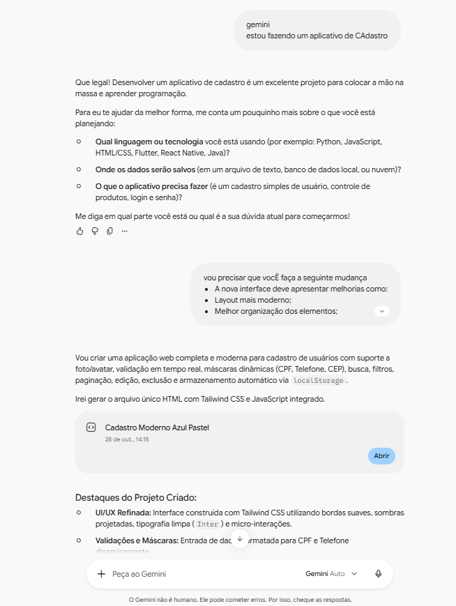

# Projeto Navegação - 2DS PW

---

## Informações do Projeto

**Nome do projeto:** Sistema de Cadastro

**Integrantes:** Rafael Piffer e Vinicius Alexandre

**Objetivo:** Desenvolver um sistema de cadastro que permita gerenciar categorias, produtos, clientes e fornecedores de um estabelecimento.

**Tecnologias utilizadas:** Node.js, Express, operações CRUD, Gemini e GitHub Copilot.

**Funcionalidades:** O sistema permite cadastrar, consultar, modificar e excluir informações, seguindo as operações CRUD (*Create, Read, Update e Delete*).

---

## Prompts Utilizados

### 1º Prompt — Gemini

```text
Estou fazendo um aplicativo de cadastro e vou precisar que você faça a seguinte mudança.

A nova interface deve apresentar melhorias como:
- Layout mais moderno;
- Melhor organização dos elementos;
- Melhor uso de cores;
- Botões e formulários aprimorados;
- Melhor experiência para o usuário;
- Responsividade, quando possível.

Lembre-se destas regras de ouro:
- Seja direto ao ponto;
- Não faça nada que não foi pedido;
- Se houver alguma possível melhoria, explique o motivo antes;
- Antes de enviar o projeto final, liste todas as mudanças feitas e avise que vai começar a implementá-las.
```

### Justificativas das Melhorias Sugeridas pela IA

**1. Visual moderno e profissional**

Uso de variáveis CSS, fontes legíveis, cantos arredondados e sombras suaves para deixar a interface mais organizada e agradável.

**2. Melhor organização dos elementos**

Utilização de CSS Grid e Flexbox para alinhar os campos e agrupar informações relacionadas, facilitando o preenchimento dos formulários.

**3. Uso estratégico de cores e feedback visual**

Aplicação de uma paleta de cores harmoniosa, com destaque para ações importantes e indicações visuais nos campos e botões.

**4. Aprimoramento de botões e campos**

Melhoria do espaçamento, da área de interação e dos efeitos visuais dos botões e campos de entrada.

**5. Responsividade**

Uso de media queries para adaptar o layout a diferentes tamanhos de tela, como celulares, tablets e computadores.

### Lista de Mudanças Sugeridas

- Criação de um container centralizado para os formulários.
- Organização dos campos com CSS Grid e Flexbox.
- Aprimoramento dos rótulos, campos de entrada e seletores.
- Inclusão de efeitos de foco nos campos e de interação nos botões.
- Definição de uma paleta de cores com bom contraste.
- Adaptação da interface para telas menores.

### 2º Prompt — GitHub Copilot

```text
Copilot, arrume todos os bugs que existem dentro deste projeto, deixe o estilo de view/index.js igual ao das demais páginas e não acrescente nada além do que foi pedido.
```

---

## Alterações Implementadas pelo Grupo

- Implementação de tema claro e tema escuro.

---

## Uso da Inteligência Artificial

**Ferramentas utilizadas:** Gemini e GitHub Copilot.

---

## Prints da Conversa com a IA




**Antes da reestilização:**

*Adicione aqui a imagem da interface antes das alterações.*

**Depois da reestilização:**

*Adicione aqui a imagem da interface depois das alterações.*

---

## Links

**Link da aplicação:** [Adicione o link aqui]

**Link do repositório:** [Adicione o link aqui]
